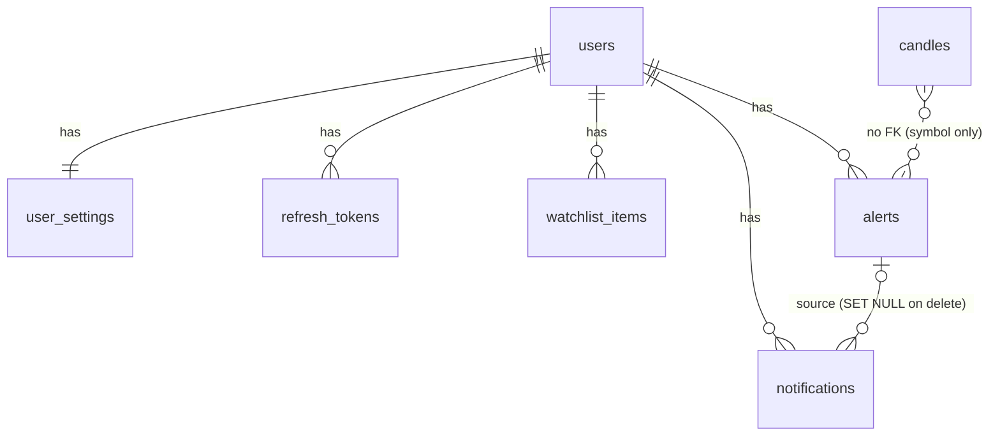

# DATABASE — Crypto Alert

> PostgreSQL 16 + Prisma. The Prisma schema in §3 is **authoritative**: copy it verbatim into `backend/prisma/schema.prisma` in Phase 0. JSON field names in `API.md` are the camelCase Prisma field names below.

## 1. Conventions

| Rule | Value |
|---|---|
| Table / column names | `snake_case` in DB (via `@@map` / `@map`); `camelCase` in Prisma and JSON |
| Primary keys | `INTEGER` autoincrement (`Int @id @default(autoincrement())`). **Never BigInt** (ADR-03). |
| Money / prices | `DECIMAL(24,8)` (Binance max 8 decimals). Volumes `DECIMAL(36,8)`. Serialized to JSON as **number** (global serializer, ADR-04). |
| Timestamps | `TIMESTAMPTZ(3)`, always UTC. API: records → ISO 8601 with `Z`; candle times → epoch ms (number). |
| Enums | Postgres enums via Prisma enums (values exactly as below). Interval is `VARCHAR(3)` + CHECK (Prisma enum values can't start with a digit). |
| Deletes | Deleting a user cascades to all their rows. Deleting an alert sets `notifications.alert_id` to NULL (history kept). |
| Business limits | Watchlist ≤ 50, ACTIVE alerts ≤ 20 — enforced in services, not in DB. |
| Email | Stored trimmed + lower-cased (CHECK enforces lower case). |

## 2. Tables

### users
| Column | Type | Constraints |
|---|---|---|
| id | integer | PK, autoincrement |
| email | varchar(254) | NOT NULL, UNIQUE, CHECK `email = lower(email)` |
| password_hash | text | NOT NULL (argon2id). **Never selected into API responses.** |
| display_name | varchar(50) | NOT NULL |
| role | user_role (`user`,`admin`) | NOT NULL, default `user` |
| created_at | timestamptz(3) | NOT NULL, default now() |
| updated_at | timestamptz(3) | NOT NULL, auto-updated |

### user_settings (1–1 with users, created together with the user)
| Column | Type | Constraints |
|---|---|---|
| user_id | integer | PK, FK → users.id ON DELETE CASCADE |
| locale | locale (`vi`,`en`) | NOT NULL, default `vi` |
| theme | theme (`dark`,`light`) | NOT NULL, default `dark` |
| timezone | varchar(64) | NOT NULL, default `Asia/Ho_Chi_Minh` (IANA name, validated in service) |
| updated_at | timestamptz(3) | NOT NULL, auto-updated |

### refresh_tokens
| Column | Type | Constraints |
|---|---|---|
| id | integer | PK |
| user_id | integer | NOT NULL, FK → users.id ON DELETE CASCADE, INDEX |
| token_hash | char(64) | NOT NULL, UNIQUE (SHA-256 hex of the raw token) |
| expires_at | timestamptz(3) | NOT NULL |
| revoked_at | timestamptz(3) | NULL = still valid |
| replaced_by_id | integer | NULL; id of the token issued on rotation (no FK) |
| created_at | timestamptz(3) | NOT NULL, default now() |

Valid token = `revoked_at IS NULL AND expires_at > now()`. Presenting a token that was **rotated** (`replaced_by_id` set) less than 10 s ago (`revoked_at > now() − 10 s`) is not reuse: issue a new token for that user and revoke nothing else (multi-tab grace window). Reuse detection (revoke ALL of that user's tokens) applies **only** to a rotated token (`replaced_by_id IS NOT NULL`) presented after the 10 s window. A token revoked by logout or change-password (`replaced_by_id IS NULL`) → `REFRESH_TOKEN_INVALID` (cookie cleared) and nothing else is revoked, so other sessions of the user stay valid. Uses existing columns only.

### watchlist_items
| Column | Type | Constraints |
|---|---|---|
| id | integer | PK |
| user_id | integer | NOT NULL, FK → users.id ON DELETE CASCADE |
| symbol | varchar(20) | NOT NULL (e.g. `BTCUSDT`) |
| created_at | timestamptz(3) | NOT NULL, default now() |

UNIQUE (user_id, symbol); INDEX (user_id, created_at). Order in UI = created_at ascending.

### alerts
| Column | Type | Constraints |
|---|---|---|
| id | integer | PK |
| user_id | integer | NOT NULL, FK → users.id ON DELETE CASCADE |
| symbol | varchar(20) | NOT NULL |
| condition | alert_condition (`ABOVE`,`BELOW`) | NOT NULL |
| target_price | decimal(24,8) | NOT NULL, CHECK `> 0` |
| status | alert_status (`ACTIVE`,`TRIGGERED`) | NOT NULL, default `ACTIVE` |
| triggered_price | decimal(24,8) | NULL until triggered |
| created_at | timestamptz(3) | NOT NULL, default now() |
| triggered_at | timestamptz(3) | NULL until triggered |

INDEX (status, symbol) — worker boot load; INDEX (user_id, created_at).
CHECK `alerts_trigger_consistency`: `(status='ACTIVE' AND triggered_at IS NULL AND triggered_price IS NULL) OR (status='TRIGGERED' AND triggered_at IS NOT NULL AND triggered_price IS NOT NULL)`.

### notifications
| Column | Type | Constraints |
|---|---|---|
| id | integer | PK |
| user_id | integer | NOT NULL, FK → users.id ON DELETE CASCADE |
| alert_id | integer | NULL, FK → alerts.id ON DELETE SET NULL |
| type | notification_type (`ALERT_TRIGGERED`) | NOT NULL |
| payload | jsonb | NOT NULL — structured data, **no human sentences** (shape below) |
| read_at | timestamptz(3) | NULL = unread |
| created_at | timestamptz(3) | NOT NULL, default now() |

INDEX (user_id, created_at DESC); INDEX (user_id, read_at).

`payload` for `ALERT_TRIGGERED` (numbers stored as JSON numbers):
```json
{ "alertId": 12, "symbol": "BTCUSDT", "condition": "ABOVE", "targetPrice": 70000, "triggeredPrice": 70012.5 }
```

### candles (cache of **closed** candles only)
| Column | Type | Constraints |
|---|---|---|
| symbol | varchar(20) | PK part |
| interval | varchar(3) | PK part, CHECK `interval IN ('1m','5m','15m','1h','4h','1d')` |
| open_time | timestamptz(3) | PK part (UTC, aligned to interval) |
| close_time | timestamptz(3) | NOT NULL |
| open, high, low, close | decimal(24,8) | NOT NULL |
| volume | decimal(36,8) | NOT NULL (base asset) |
| quote_volume | decimal(36,8) | NOT NULL (USDT) |

PK (symbol, interval, open_time) also serves the range query `WHERE symbol=? AND interval=? AND open_time BETWEEN ? AND ? ORDER BY open_time`. Writes are upserts. No pruning in this project (small volume).

## 3. Prisma schema (authoritative)

```prisma
generator client {
  provider = "prisma-client-js"
}

datasource db {
  provider = "postgresql"
  url      = env("DATABASE_URL")
}

enum UserRole {
  user
  admin

  @@map("user_role")
}

enum Locale {
  vi
  en

  @@map("locale")
}

enum Theme {
  dark
  light

  @@map("theme")
}

enum AlertCondition {
  ABOVE
  BELOW

  @@map("alert_condition")
}

enum AlertStatus {
  ACTIVE
  TRIGGERED

  @@map("alert_status")
}

enum NotificationType {
  ALERT_TRIGGERED

  @@map("notification_type")
}

model User {
  id             Int             @id @default(autoincrement())
  email          String          @unique @db.VarChar(254)
  passwordHash   String          @map("password_hash")
  displayName    String          @map("display_name") @db.VarChar(50)
  role           UserRole        @default(user)
  createdAt      DateTime        @default(now()) @map("created_at") @db.Timestamptz(3)
  updatedAt      DateTime        @updatedAt @map("updated_at") @db.Timestamptz(3)
  settings       UserSettings?
  refreshTokens  RefreshToken[]
  watchlistItems WatchlistItem[]
  alerts         Alert[]
  notifications  Notification[]

  @@map("users")
}

model UserSettings {
  userId    Int      @id @map("user_id")
  locale    Locale   @default(vi)
  theme     Theme    @default(dark)
  timezone  String   @default("Asia/Ho_Chi_Minh") @db.VarChar(64)
  updatedAt DateTime @updatedAt @map("updated_at") @db.Timestamptz(3)
  user      User     @relation(fields: [userId], references: [id], onDelete: Cascade)

  @@map("user_settings")
}

model RefreshToken {
  id           Int       @id @default(autoincrement())
  userId       Int       @map("user_id")
  tokenHash    String    @unique @map("token_hash") @db.Char(64)
  expiresAt    DateTime  @map("expires_at") @db.Timestamptz(3)
  revokedAt    DateTime? @map("revoked_at") @db.Timestamptz(3)
  replacedById Int?      @map("replaced_by_id")
  createdAt    DateTime  @default(now()) @map("created_at") @db.Timestamptz(3)
  user         User      @relation(fields: [userId], references: [id], onDelete: Cascade)

  @@index([userId])
  @@map("refresh_tokens")
}

model WatchlistItem {
  id        Int      @id @default(autoincrement())
  userId    Int      @map("user_id")
  symbol    String   @db.VarChar(20)
  createdAt DateTime @default(now()) @map("created_at") @db.Timestamptz(3)
  user      User     @relation(fields: [userId], references: [id], onDelete: Cascade)

  @@unique([userId, symbol])
  @@index([userId, createdAt])
  @@map("watchlist_items")
}

model Alert {
  id             Int            @id @default(autoincrement())
  userId         Int            @map("user_id")
  symbol         String         @db.VarChar(20)
  condition      AlertCondition
  targetPrice    Decimal        @map("target_price") @db.Decimal(24, 8)
  status         AlertStatus    @default(ACTIVE)
  triggeredPrice Decimal?       @map("triggered_price") @db.Decimal(24, 8)
  createdAt      DateTime       @default(now()) @map("created_at") @db.Timestamptz(3)
  triggeredAt    DateTime?      @map("triggered_at") @db.Timestamptz(3)
  user           User           @relation(fields: [userId], references: [id], onDelete: Cascade)
  notifications  Notification[]

  @@index([status, symbol])
  @@index([userId, createdAt])
  @@map("alerts")
}

model Notification {
  id        Int              @id @default(autoincrement())
  userId    Int              @map("user_id")
  alertId   Int?             @map("alert_id")
  type      NotificationType
  payload   Json             @db.JsonB
  readAt    DateTime?        @map("read_at") @db.Timestamptz(3)
  createdAt DateTime         @default(now()) @map("created_at") @db.Timestamptz(3)
  user      User             @relation(fields: [userId], references: [id], onDelete: Cascade)
  alert     Alert?           @relation(fields: [alertId], references: [id], onDelete: SetNull)

  @@index([userId, createdAt(sort: Desc)])
  @@index([userId, readAt])
  @@map("notifications")
}

model Candle {
  symbol      String   @db.VarChar(20)
  interval    String   @db.VarChar(3)
  openTime    DateTime @map("open_time") @db.Timestamptz(3)
  closeTime   DateTime @map("close_time") @db.Timestamptz(3)
  open        Decimal  @db.Decimal(24, 8)
  high        Decimal  @db.Decimal(24, 8)
  low         Decimal  @db.Decimal(24, 8)
  close       Decimal  @db.Decimal(24, 8)
  volume      Decimal  @db.Decimal(36, 8)
  quoteVolume Decimal  @map("quote_volume") @db.Decimal(36, 8)

  @@id([symbol, interval, openTime])
  @@map("candles")
}
```

### 3.1 Raw SQL appended to the `init` migration
Create the migration with `prisma migrate dev --name init --create-only`, append this to its `migration.sql`, then apply:

```sql
ALTER TABLE "users"   ADD CONSTRAINT "users_email_lowercase" CHECK ("email" = lower("email"));
ALTER TABLE "alerts"  ADD CONSTRAINT "alerts_target_price_positive" CHECK ("target_price" > 0);
ALTER TABLE "alerts"  ADD CONSTRAINT "alerts_trigger_consistency" CHECK (
  ("status" = 'ACTIVE'    AND "triggered_at" IS NULL     AND "triggered_price" IS NULL) OR
  ("status" = 'TRIGGERED' AND "triggered_at" IS NOT NULL AND "triggered_price" IS NOT NULL));
ALTER TABLE "candles" ADD CONSTRAINT "candles_interval_valid" CHECK ("interval" IN ('1m','5m','15m','1h','4h','1d'));
```

## 4. Relations



## 5. Migration policy

| Rule | Detail |
|---|---|
| First migration | Phase 0 creates **one** migration `init` with the full schema of §3 + §3.1 (all tables exist from day one, even if features come later). |
| Every change | Edit `schema.prisma` → `npx prisma migrate dev --name <snake_case_description>` → commit the schema **and** the new `prisma/migrations/<timestamp>_<name>/` folder together. Update this file in the same commit. |
| Forbidden | `prisma db push` (anywhere), editing or deleting an already-committed migration, manual DDL on the deployed DB. |
| Local dev DB | `crypto_alert` (docker-compose). `prisma migrate dev` allowed. |
| Test DB | `crypto_alert_test`. The integration-test script and the Playwright `webServer` run `prisma migrate deploy` against the test `DATABASE_URL` before running (locally and in CI). Between tests: `TRUNCATE users, candles RESTART IDENTITY CASCADE` (via `POST /api/v1/test/reset`), then seed. |
| Production | `prisma migrate deploy` runs in the start command before the app boots. |
| Rollback | Never "down" migrate. Fix forward with a new migration. |

## 6. Seed policy (`backend/prisma/seed.ts`, run with `npm run db:seed -w backend`)

Idempotent: upserts the demo user, then **deletes and recreates** only the demo user's watchlist, alerts and notifications. Never touches other users.

| Data | Value |
|---|---|
| User | email `demo@example.com`, password `Demo@123456`, display name `Demo User`, role `user` |
| Settings | `vi`, `dark`, `Asia/Ho_Chi_Minh` |
| Watchlist | `BTCUSDT`, `ETHUSDT`, `SOLUSDT` (in this order) |
| Active alerts | `BTCUSDT ABOVE 1000000`; `ETHUSDT BELOW 100` (far from real prices so they don't fire during a demo) |
| Triggered alert | `SOLUSDT ABOVE 100`, `triggered_price 101.5`, `triggered_at` = seed time − 1 h |
| Notification | 1 unread `ALERT_TRIGGERED` for the triggered alert (payload per §2) |

Satisfies AC-OPS-02. The seed never creates candles.
